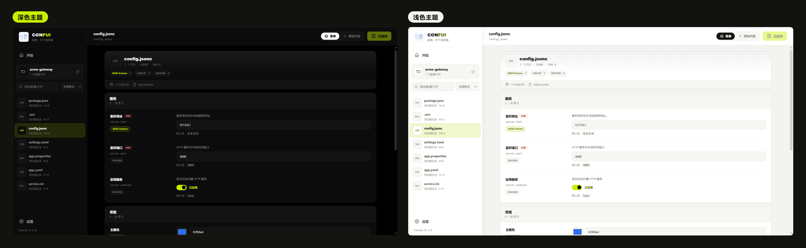
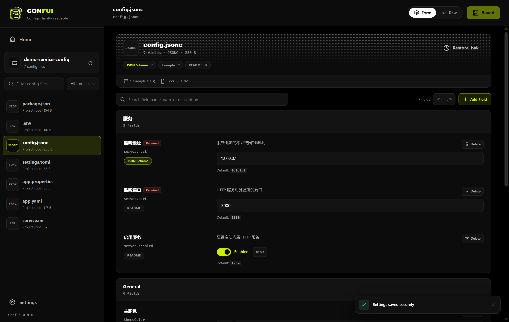

<p align="right"><a href="README.md">简体中文</a> | <strong>English</strong></p>

# Confui

Confui is a Windows x64 desktop configuration editor. Point it at a local project folder and it discovers editable configuration files, merges metadata from JSON Schema, built-in templates, opt-in SchemaStore mappings, inline file comments, example files, READMEs, and optional AI providers, and presents a validated desktop form with undo/redo, object-array cards, nested object trees, and diff confirmation. Changes are only written after you review the field-level diff or Unified Diff, with automatic `.bak` backups and out-of-repo encrypted named snapshots for reversible rollback.



<p align="center"><em>Confui v0.5.0 desktop form editor (Light theme · multi-layer inference badges · one-click <code>.bak</code> & named snapshot restore)</em></p>

| Save Confirmation & Unified Diff Preview | Dark Theme & English UI |
| :---: | :---: |
|  |  |

## Community

Confui is shared on the LINUX DO community — feedback and discussion are welcome in the [open-source thread](https://linux.do/t/topic/2614137).

## Key Features

- **Format-Preserving & Multi-Document YAML Write-Back**: JSON / JSONC (AST incremental edits), YAML (`yaml` v2 CST incremental edits with lossless `---` multi-document switching, K8s `kind/metadata.name` & Spring Boot `on-profile` labels, and byte-for-byte preservation of untouched sibling documents), TOML (in-place source patcher validated with `smol-toml`), and line-preserving ENV / INI (with native `.editorconfig` and `.npmrc` support) / Java Properties editors — including monorepo subdirectory dotfiles (`.env.*`, `.npmrc`, `.editorconfig`, `.eslintrc`, `.prettierrc`).
- **Project Config Diagnostics Dashboard (v0.5.0)**: One-click project-wide health scan from the top bar or `Ctrl+K` (bounded concurrency, byte budget, and physical path containment) categorizing four issue classes: (1) syntax/parse errors (`parse-error`), (2) JSON Schema / built-in template violations (missing required keys, type mismatches, range/length/enum/regex violations), (3) missing keys relative to companion `.env.example` / `*.example` files (`missing-from-example`), and (4) suspected plaintext secret alerts (location and key name only — never returns or displays secret values). Filter by Error / Warning / Info and click any item to open the file and scroll/highlight the target field (preserving unsaved-change protection).
- **Out-of-Repo Named Snapshots & Rollback (v0.5.0)**: Create labeled snapshots with timestamps and SHA-256 hashes from the editor toolbar or `Ctrl+K`. Snapshots are authenticated-encrypted with AES-256-GCM + Electron `safeStorage` inside `userData/snapshots/<projectSha256>/` (capped at 50 snapshots per project and 5 MB per file; never writes extra files into your project repository). Restoring previews the Unified Diff with secrets masked by default (`••••••••`) and writes atomically via `commitSave` with an automatic `.bak` backup.
- **Project-Wide Config Search & `Ctrl+K` Command Palette**: Concurrently searches readable configs by key path, non-secret values, and comments, plus deep jumping to nested object paths and array cards in the active file; secret hits are strictly redacted to location-only (`••••••••`). Aggregates diagnostics, snapshots, save, `.bak` restore, compare/sync, redacted export, rescan, and theme/language commands.
- **Template Initialization, Multi-Env Compare/Sync & Redacted Export**: Detects unpaired example templates (`.env.example`, `config.example.jsonc/yaml/toml`) for one-click safe creation (`open(..., "wx")` never overwrites and rejects symlinks); groups multi-environment config families for structured key diffing (including multi-doc YAML selection) and batch sync; exports comment-preserving redacted copies.
- **Object-Array Cards, Nested Trees & Large-File Ergonomics**: Visual card editor for object arrays (auto-extracted card titles/badges, duplicate/reorder, per-card JSON toggle, schema `items.properties` controls), recursive nested object trees (up to 4 levels with structured JSON block fallback), visual scalar lists, and flat key-value tables; collapsible groups, status filter pills (`All` / `Modified` / `Errors` / `Required`), safe `Ctrl+Z` / `Ctrl+Y` undo/redo, drag-and-drop project opening, and virtualized Raw source view with search navigation.
- **Verifiable Safe Write-Back & Bilingual UI**: Field Diff (`Added` / `Modified` / `Removed`) and Unified Diff preview with secrets masked by default (`••••••••`) and an explicit reveal toggle; atomic temp-file replacement with Windows `EPERM`/`EBUSY` retry and `.bak` rollback; full `zh-CN` / `en-US` UI and bilingual AI field explanations.

## Supported Formats

| Format | Parsing | Write-Back Strategy |
| --- | --- | --- |
| JSON / JSONC | Comments, trailing commas, duplicate-key rejection (`.eslintrc`, `.prettierrc`) | `jsonc-parser` AST incremental patching preserving comments, indentation, and key order |
| YAML / YML | Full `yaml` v2 parsing; multi-doc `---` switching, numeric/boolean map keys, and shared aliases (cyclic aliases rejected) | CST incremental write-back splicing only the edited document span; preserves comments, indentation, key order, and special scalars; falls back with an explicit warning only when crossing alias references |
| TOML | Full `smol-toml` parsing (`TomlDate`, BigInt, `inf`/`nan`) and `#:schema` directives | In-place source patcher preserving comments, blank lines, and table order; falls back with an explicit warning only for complex inline tables or arrays of tables |
| ENV | `export` prefix, quotes, escapes, and inline comments (including subdirectory `.env.*`) | Line-by-line patching with strict key-name validation preserving comments and quoting style |
| INI / CFG / CONF | Strict INI syntax (`[section]`, `=`/`:`, `key[]` arrays, dotted subsections), native `.editorconfig` and `.npmrc`; directive-style `.conf`/`.cfg` (nginx, httpd, redis) marked unsupported | Line-by-line patching rejecting invalid `=`/newline/control-character keys while preserving comments and sections |
| Java Properties | Escaped keys and backslash line continuations | Logical-line patching preserving neighboring comments |

JavaScript / TypeScript config files (e.g. `vite.config.ts`) are never opened as JSON. Example files, lockfiles, schema files, `.bak` backups, and build/dependency directories are excluded from the editable list.

## Inference Pipeline

Each layer contributes individual field properties rather than replacing whole fields:

1. **JSON Schema**: JSON `$schema`, YAML `# yaml-language-server: $schema=...`, TOML `#:schema ...`, sibling `{name}.schema.json`, `schema.json`, local refs, allowlisted remote schemas, `$ref`, `allOf` / `anyOf` / `oneOf`, and `items.properties`
2. **Built-in Templates** (bilingual zh-CN / en-US): `package.json`, `tsconfig.json` / `jsconfig.json`, ESLint, Prettier, `docker-compose.yml` / `compose.yaml`, `pyproject.toml`, `Cargo.toml`, `launch.json`, `vercel.json`, and common `.env` keys
3. **SchemaStore Remote Mapping** (opt-in, off by default): When explicitly enabled in Settings, matches common filenames against `json.schemastore.org` over HTTPS with a 7-day local disk cache and explicit source badge
4. **File Comments**: All-format AST/CST extraction of leading and inline comments as field descriptions, sanitized to strip secret patterns and multi-line PEM blocks
5. **Example Files**: `*.example`, `*.sample`, `*.template`, `*.dist`, `*.default`
6. **README Docs**: Local root / `docs/` README first; falls back to GitHub README API when absent locally and a valid GitHub URL is supplied
7. **AI Analysis** (optional): Any user-configured OpenAI-compatible `/chat/completions` provider
8. **Structure Heuristics**: Inferred from current value shapes and key names

Defaults from schemas or examples are never written implicitly; empty fields offer a manual "Use Default" action. When an AI provider is enabled, clicking "Explain" beside any field requests a read-only explanation and caution note with secrets redacted beforehand.

## Security & Save Guarantees

- Renderer runs with `contextIsolation: true`, `sandbox: true`, and `nodeIntegration: false`, communicating strictly over a typed `contextBridge` IPC allowlist with zero HTTP backend.
- Every file read, diagnostic scan, snapshot capture, save, and `.bak` restore validates physical paths (`realpath` + `lstat`) inside the selected project directory and rejects symlink/junction escapes.
- The main process independently recomputes save output from validated operations (or verifies snapshot SHA-256 integrity against `userData/snapshots/`) and re-checks file SHA-256 hashes before writing; Unified Diff views mask sensitive values by default (`••••••••`) with an explicit reveal toggle.
- Named snapshots are AES-256-GCM encrypted with `safeStorage`-wrapped keys inside Confui's app data directory (`userData/snapshots/<projectSha256>/`), never touching the user's repository until an explicit, `.bak`-backed restore.
- Project diagnostics and cross-file search enforce bounded concurrency, byte budgets, and item limits; plaintext secret alerts and secret search hits report location and key name only, never exposing secret values.
- Example template initialization enforces physical `realpath` containment, rejects symlinks in both source and target paths, and writes exclusively via `open(..., "wx")`.
- Both config saves and settings persistence use atomic same-directory temp swaps with Windows `EPERM`/`EBUSY` backoff retry and atomic `.bak` promotion.
- API keys and GitHub tokens are encrypted via Electron `safeStorage`, redacted before crossing to the renderer, and preserved untouched when the OS keychain is unavailable; outbound AI prompts recursively redact secrets.

## Development

Requires Node.js 22.12+ on Windows PowerShell:

```powershell
npm ci
npm run dev
```

Full verification (`tsc --noEmit` + all unit/integration/E2E tests + `electron-vite build`):

```powershell
npm run check
```

Run E2E & UI integration suites directly:

```powershell
npm run test:e2e
```

Audit production dependencies (must report 0 high/critical vulnerabilities):

```powershell
npm audit --omit=dev --audit-level=high --registry=https://registry.npmjs.org
```

Build the Windows x64 portable directory:

```powershell
npm run package
```

The portable output is generated at `release/Confui-win32-x64/Confui.exe`. Distribute the entire `Confui-win32-x64` directory as a ZIP archive (keeping sibling DLLs, `locales`, and `resources` intact — it is not a single-file binary).

## Directory Layout

```text
core/
  formats/        Multi-format parse & write-back engines (json / yaml / toml / env / ini / properties)
  inference/      8-layer inference pipeline (JSON Schema / built-in / SchemaStore / comment / example / README / AI / heuristic)
  ai/             OpenAI-compatible client and connection test
  scanner.ts      Streaming project scanner, orphan template discovery & multi-env grouping
  search.ts       Bounded concurrent cross-file redacted configuration search engine
  diagnostics.ts  Project-wide config health diagnostics (parse / schema / missing example / plaintext secret alerts)
  snapshots.ts    Out-of-repo AES-256-GCM / safeStorage encrypted named snapshots & verified restore
  save.ts         Diff preview, atomic save, .bak rollback, template init, compare/sync & redacted export
  settings.ts     Settings normalization, Windows rename retry & safeStorage encryption
electron/         Main process, window lifecycle, CSP, file watcher, and sandboxed preload bridge
shared/           IPC & FormSchema contracts, shared validation helpers, and LCS Unified Diff engine
web/src/          Preact desktop renderer (components / hooks / i18n / utils)
tests/            Unit, end-to-end (e2e-project), and UI integration test suites
scripts/          Deterministic Windows x64 portable packaging script
```

See [AGENTS.md](AGENTS.md) and [PROJECT_SPEC.md](PROJECT_SPEC.md) for architecture boundaries and contribution rules.

## Network Activity

Confui only makes network requests in four explicit situations; everything else stays strictly local:

| Purpose | Destination | Trigger |
| --- | --- | --- |
| Fallback documentation | GitHub README API | Local README is absent and a valid GitHub repo URL is provided |
| Explicit remote Schema | Allowlisted hosts only (`json.schemastore.org`, `schemastore.org`, `raw.githubusercontent.com`, `unpkg.com`, `cdn.jsdelivr.net`) | Config declares an `https` `$schema` or YAML/TOML schema directive on an allowlisted host |
| SchemaStore auto-mapping | `json.schemastore.org` only | Opt-in toggle enabled in Settings; matches common filenames with a 7-day local disk cache |
| Update check | GitHub Release API | Clicking "Check Updates" in Settings |

Remote schema URLs must use `https`, default port, and no query/hash. AI requests are sent exclusively to the user-configured Base URL (`http`/`https`, credentials in URL forbidden).

## Known Boundaries

- GitHub URLs are only used as a documentation fallback when no local README exists; editing always requires a local project directory.
- Standard YAML and TOML edits preserve comments and layout; edits crossing YAML alias references or complex TOML inline/array tables fall back safely to full serialization with an explicit preview notice.
- Acyclic YAML aliases are supported; cyclic YAML aliases are rejected safely to avoid editor crashes.
- SchemaStore and AI are optional enhancement layers; all other local inference, diagnostics, and snapshot capabilities work completely offline.
- Portable builds are unsigned, so Windows SmartScreen may display an "Unknown publisher" notice on first launch.

## License

[MIT](LICENSE)
