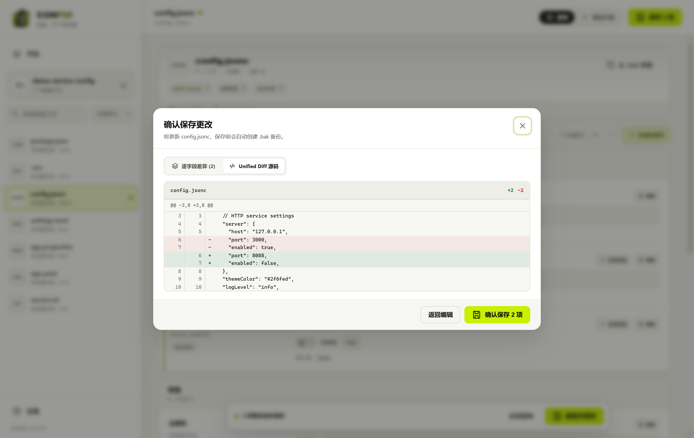

<p align="right"><a href="README.md">简体中文</a> | <strong>English</strong></p>

# Confui

Confui is a Windows x64 desktop configuration editor. Point it at a local project folder and it discovers editable configuration files, merges metadata from JSON Schema, built-in templates, example files, READMEs, and optional AI providers, and presents a validated desktop form with undo/redo, visual array/object editing, and diff confirmation. Changes are only written after you review the field-level diff or Unified Diff, with automatic `.bak` backups and one-click rollback.


<p align="center"><em>Confui v0.4.0 desktop form editor (Light theme · multi-layer inference badges · one-click <code>.bak</code> restore)</em></p>

| Save Confirmation & Unified Diff Preview | Dark Theme & English UI |
| :---: | :---: |
|  |  |

## Community

Confui is shared on the LINUX DO community — feedback and discussion are welcome in the [open-source thread](https://linux.do/t/topic/2614137).

## Key Features

- **Format-Preserving Write-Back**: JSON / JSONC (AST incremental edits), YAML (`yaml` v2 CST incremental edits), TOML (in-place source patcher validated with `smol-toml`), and line-preserving ENV / INI / Java Properties editors.
- **Project-Wide Config Search & `Ctrl+K` Command Palette**: Concurrently searches readable configs (bounded concurrency, byte budget, and hit limits) by key path, non-secret values, and comments while strictly redacting secret hits to location-only (`••••••••`); jump directly to and highlight target fields (preserving unsaved-change guards) and invoke high-frequency actions (save, `.bak` restore, compare/sync, redacted export, rescan, theme/language toggle).
- **Template Initialization, Multi-Env Compare/Sync & Redacted Export**: Detects unpaired example templates (e.g. `.env.example`, `config.example.jsonc/yaml/toml`) for one-click safe creation in the sidebar (`open(..., "wx")` never overwrites and blocks symlinks); groups multi-environment config families (`.env` + `.env.production`, `app.yaml` + `app-prod.yaml`) for structured key diffing and selective batch sync with secrets masked by default; exports comment-preserving redacted copies via `maskDocumentSecrets`.
- **Editor Ergonomics & Large-File Performance**: Visual list editing for scalar arrays and key-value tables for flat objects with one-click JSON toggle; collapsible field groups, status filter pills (`All` / `Modified` / `Errors` / `Required`), exact numeric input beside integer range sliders, safe `Ctrl+Z` / `Ctrl+Y` undo/redo that never hijacks text inputs, drag-and-drop folder opening on Home, and fixed-row-height virtual scrolling with search navigation in Raw view.
- **Safe Diff Preview, Secret Masking & `.bak` Rollback**: Switch between Field Diff (`Added` / `Modified` / `Removed`) and Unified Diff with sensitive values masked by default (`••••••••`) plus an explicit Show/Hide secrets toggle to prevent screen-share leaks; atomic temp-file replacement with Windows `EPERM`/`EBUSY` retry and `.bak` rollback; full `zh-CN` / `en-US` UI and bilingual AI field explanation.

## Supported Formats

| Format | Parsing | Write-Back Strategy |
| --- | --- | --- |
| JSON / JSONC | Comments, trailing commas, duplicate-key rejection | `jsonc-parser` AST incremental patching preserving comments, indentation, and key order |
| YAML / YML | Full `yaml` v2 parsing; shared aliases supported, cyclic aliases rejected | CST incremental write-back preserving comments, indentation, key order, and special scalars; falls back with an explicit warning only when crossing alias references |
| TOML | Full `smol-toml` parsing (preserves `TomlDate`, BigInt, and `inf`/`nan`) | In-place source patcher preserving comments, blank lines, and table order; falls back with an explicit warning only for complex inline tables or arrays of tables |
| ENV | `export` prefix, quotes, escapes, and inline comments | Line-by-line patching preserving neighboring comments and quoting style |
| INI / CFG / CONF | Strict INI syntax (`[section]`, `=`/`:`, `key[]` arrays); directive-style `.conf`/`.cfg` files (nginx, httpd, redis) are flagged unsupported | Line-by-line patching preserving comments and sections |
| Java Properties | Escaped keys and backslash line continuations | Logical-line patching preserving neighboring comments |

JavaScript / TypeScript config files (e.g. `vite.config.ts`) are never opened as JSON. Example files, lockfiles, schema files, `.bak` backups, and build/dependency directories are excluded from the editable list.

## Inference Pipeline

Each layer contributes individual field properties rather than replacing whole fields:

1. **JSON Schema**: `$schema`, sibling `{name}.schema.json`, `schema.json`, local refs, allowlisted remote schemas, `$ref`, and `allOf`
2. **Built-in Templates** (bilingual zh-CN / en-US): `package.json`, `tsconfig.json` / `jsconfig.json`, ESLint, Prettier, `docker-compose.yml` / `compose.yaml`, `pyproject.toml`, `Cargo.toml`, and common `.env` keys (`PORT`, `HOST`, `NODE_ENV`, `DATABASE_URL`, `REDIS_URL`, `LOG_LEVEL`, etc.)
3. **Example Files**: `*.example`, `*.sample`, `*.template`, `*.dist`, `*.default`
4. **README Docs**: Local root / `docs/` README first; falls back to GitHub README API when absent locally and a valid GitHub URL is supplied
5. **AI Analysis** (optional): Any user-configured OpenAI-compatible `/chat/completions` provider
6. **Structure Heuristics**: Inferred from current value shapes and key names

Defaults from schemas or examples are never written implicitly; empty fields offer a manual "Use Default" action. When an AI provider is enabled, clicking "Explain" beside any field requests a read-only explanation and caution note with secrets redacted beforehand.

## Security & Save Guarantees

- Renderer runs with `contextIsolation: true`, `sandbox: true`, and `nodeIntegration: false`, communicating strictly over a typed `contextBridge` IPC allowlist with zero HTTP backend.
- Every file read, save, and `.bak` restore validates physical paths (`realpath` + `lstat`) inside the selected project directory and rejects symlinks/junction escapes.
- The main process re-generates save output from validated operations and re-verifies SHA-256 file hashes before writing, preventing stale overwrites or renderer tampering; Unified Diff views mask sensitive values by default (`••••••••`) with an explicit reveal toggle.
- Example template initialization validates physical `realpath` containment, rejects symlinks in both source and target directory chains, and writes exclusively via `open(..., "wx")` so existing files are never overwritten.
- Cross-file project search enforces bounded concurrency, byte budgets, and hit caps, skips oversized/unsupported files, never matches plaintext secret values, and redacts secret key hits to location-only.
- Both config saves and settings persistence use atomic same-directory temp swaps with Windows `EPERM`/`EBUSY` backoff retry and atomic `.bak` promotion.
- Oversized configs cap displayed fields at the top 2,000 by priority; streaming project scans cap at 50,000 entries and 4,000 config files.
- API keys and GitHub tokens are encrypted via Electron `safeStorage`, redacted before crossing to the renderer, and preserved untouched when the OS keychain is unavailable.
- Outbound AI prompts recursively redact passwords, tokens, private keys, DSNs, `Authorization` headers, and common vendor API key formats.

## Development

Requires Node.js 22.12+ on Windows PowerShell:

```powershell
npm ci
npm run dev
```

Full verification (`tsc --noEmit` + all unit/integration/E2E tests + `electron-vite build`):

```powershell
npm run check
```

Run E2E & UI integration suites directly:

```powershell
npm run test:e2e
```

Audit production dependencies (must report 0 high/critical vulnerabilities):

```powershell
npm audit --omit=dev --audit-level=high --registry=https://registry.npmjs.org
```

Build the Windows x64 portable directory:

```powershell
npm run package
```

The portable output is generated at `release/Confui-win32-x64/Confui.exe`. Distribute the entire `Confui-win32-x64` directory as a ZIP archive (keeping sibling DLLs, `locales`, and `resources` intact — it is not a single-file binary).

## Directory Layout

```text
core/
  formats/    Multi-format parse & write-back engines (json / yaml / toml / env / ini / properties)
  inference/  6-layer inference pipeline (JSON Schema / built-in / example / README / AI / heuristic)
  ai/         OpenAI-compatible client and connection test
  scanner.ts  Streaming project scanner, orphan template discovery & multi-env grouping
  search.ts   Bounded concurrent cross-file redacted configuration search engine
  save.ts     Diff preview, atomic save, .bak rollback, template init, compare/sync & redacted export
  settings.ts Settings normalization, Windows rename retry & safeStorage encryption
electron/     Main process, window lifecycle, CSP, file watcher, and sandboxed preload bridge
shared/       IPC & FormSchema contracts, shared validation helpers, and LCS Unified Diff engine
web/src/      Preact desktop renderer (components / hooks / i18n / utils)
tests/        Unit, end-to-end (e2e-project), and UI integration test suites
scripts/      Deterministic Windows x64 portable packaging script
```

See [AGENTS.md](AGENTS.md) and [PROJECT_SPEC.md](PROJECT_SPEC.md) for architecture boundaries and contribution rules.

## Network Activity

Confui only makes network requests in three explicit situations; everything else stays strictly local:

| Purpose | Destination | Trigger |
| --- | --- | --- |
| Fallback documentation | GitHub README API | Local README is absent and a valid GitHub repo URL is provided |
| Remote JSON Schema | Allowlisted hosts only (`json.schemastore.org`, `schemastore.org`, `raw.githubusercontent.com`, `unpkg.com`, `cdn.jsdelivr.net`) | Config declares an `https` `$schema` on an allowlisted host |
| Update check | GitHub Release API | Clicking "Check Updates" in Settings |

Remote `$schema` URLs must use `https`, default port, and no query/hash; responses are cached in memory for 10 minutes. AI requests are sent exclusively to the user-configured Base URL (`http`/`https`, credentials in URL forbidden).

## Known Boundaries

- GitHub URLs are only used as a documentation fallback when no local README exists; editing always requires a local project directory.
- Standard YAML and TOML edits preserve comments and layout; edits crossing YAML alias references or complex TOML inline/array tables fall back safely to full serialization with an explicit preview notice.
- Acyclic YAML aliases are supported; cyclic YAML aliases are rejected safely to avoid editor crashes.
- AI is an optional final fallback; all other layers work completely offline.
- Portable builds are unsigned, so Windows SmartScreen may display an "Unknown publisher" notice on first launch.

## License

[MIT](LICENSE)
